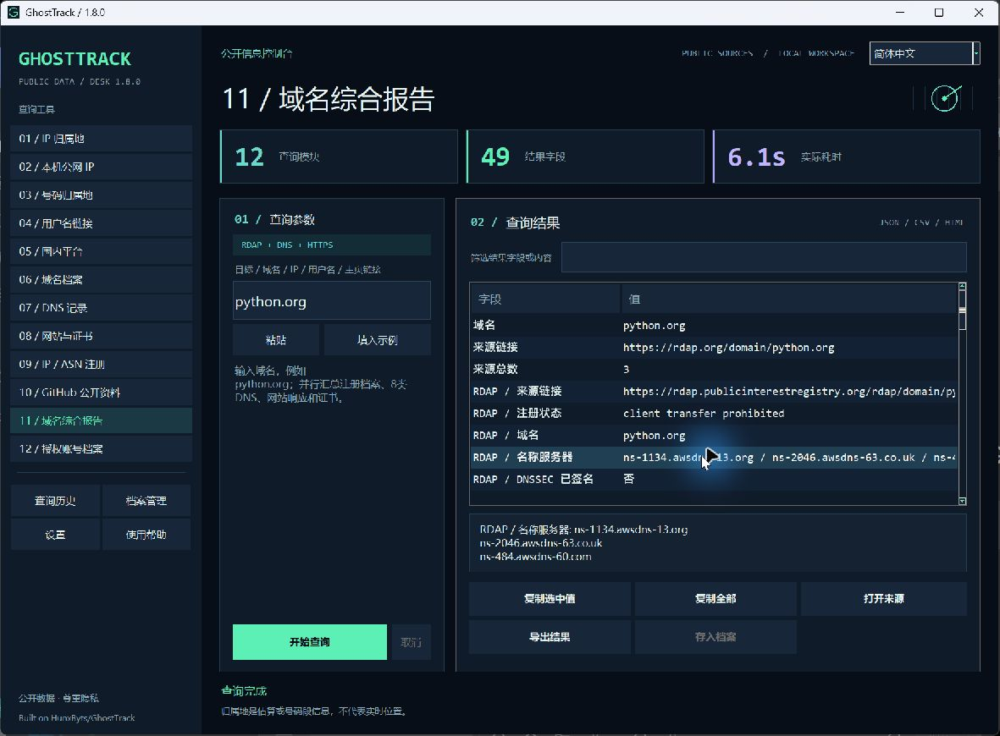
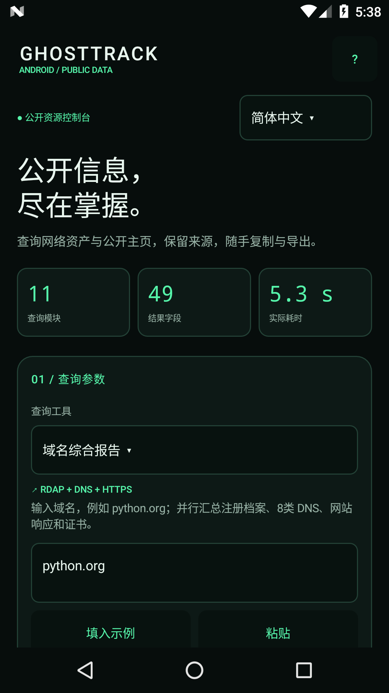

# GhostTrack Console

[简体中文](README.md) · [English](README.en.md) · [日本語](README.ja.md) · **Español** · [Français](README.fr.md)

Consola de información pública para Windows y Android. Doce herramientas de Windows y once módulos de Android comparten los mismos servicios de consulta para mostrar registros de dominios, DNS, certificados web, registros de redes y perfiles públicos en una interfaz oscura con estado de las fuentes y resultados exportables.

> La documentación está en chino, inglés, japonés, español y francés. La interfaz de la aplicación admite cuatro idiomas: chino simplificado, inglés, japonés y español.

## Descarga e instalación

| Plataforma | Descarga actual | Instalación |
|---|---|---|
| Windows 10/11 x64 · v1.8.0 | [ZIP portátil](https://github.com/Serennity007/GhostTrack/releases/download/windows-v1.8.0/GhostTrack-v1.8.0-Windows-x64.zip) · [Versión y SHA256](https://github.com/Serennity007/GhostTrack/releases/tag/windows-v1.8.0) | Extrae todo el archivo y ejecuta `GhostTrack/GhostTrack.exe` |
| Android 7.0 o posterior · v1.6.0 | [APK universal](https://github.com/Serennity007/GhostTrack/releases/download/android-v1.6.0/GhostTrack-v1.6.0-Android-universal.apk) · [Versión y SHA256](https://github.com/Serennity007/GhostTrack/releases/tag/android-v1.6.0) | Abre el APK desde el gestor de archivos del teléfono |

Windows no requiere instalar Python. Mantén el ejecutable junto a todas sus dependencias. El APK incluye ARM64, ARMv7 y x86_64; el primer inicio extrae el entorno incorporado. Autoriza la instalación solo a la aplicación que utilices para abrir el APK. Para actualizar, utiliza APK de este repositorio firmados con el mismo certificado.

[Guía de Windows, en chino](README_WINDOWS.md) · [Guía y compilación de Android, en chino](README_ANDROID.md) · [Cambios](CHANGELOG.md)

## Interfaz





Windows v1.8.0 utiliza un espacio de trabajo de dos columnas:

- Entradas, ejemplos y contexto de las fuentes a la izquierda; tabla de resultados y detalle del valor completo a la derecha.
- La navegación numerada y compacta reúne las doce herramientas. Las tarjetas muestran el número real de campos, el tiempo transcurrido y el estado de la consulta.
- La barra de acciones se adapta al ancho de la ventana, con filtros, copia y exportación junto a los resultados.

Los gráficos decorativos no indican un escaneo del objetivo. Los resultados y estados reflejan los datos recibidos. La última versión de Android sigue siendo v1.6.0.

## Doce herramientas de consulta

| Herramienta | Entrada | Información pública disponible |
|---|---|---|
| Archivo autorizado | Teléfono o palabra clave | Asociaciones teléfono-perfil autorizadas guardadas en este equipo, con fuente y fecha |
| Informe de dominio | Dominio | RDAP, DNS y HTTPS en paralelo, con estado por fuente |
| Registro de dominio | Dominio | Registrador, fechas de alta/caducidad/actualización, DNSSEC y servidores de nombres |
| Registros DNS | Dominio | A, AAAA, CNAME, MX, NS, TXT, SOA, CAA y TTL |
| Sitio web y certificado | URL HTTPS pública | Estado HTTP, título, redirecciones, cabeceras públicas, emisor/validez/SAN de TLS |
| Registro IP / ASN | IP pública o `AS15169` | Rangos registrados, CIDR, nombres de red, códigos de país y fechas |
| Perfil público de GitHub | Usuario o URL del perfil | Biografía pública, contadores, fecha de creación y cinco repositorios públicos recientes |
| Perfiles de plataformas chinas | URL del perfil, texto compartido o ID de usuario de la plataforma | Título y descripción accesibles, estado de acceso, fuente y hora de consulta |
| Ubicación de IP | IPv4 / IPv6 pública | Ubicación estimada por bases de datos, organización, proveedor, ASN y zona horaria |
| Mi IP pública | Sin entrada | IP pública de salida de la red actual |
| Metadatos telefónicos | Número y región predeterminada | Análisis local de región de numeración, operador, zonas horarias, formatos y validez |
| Enlaces por usuario | Nombre de usuario | Genera enlaces a GitHub, Instagram y X sin confirmar la existencia de la cuenta |

Plataformas compatibles: **Douyin, Xiaohongshu, Kuaishou, Bilibili, Weibo, Zhihu y Douban**. Utiliza preferiblemente la URL completa del perfil. Se pueden resolver algunos enlaces cortos de perfiles de Douyin y Xiaohongshu. Los nombres visibles, los identificadores públicos de Douyin y los enlaces a vídeos o notas no sustituyen el identificador de perfil requerido.

## Uso de los resultados

- Rellena un ejemplo sin enviar una solicitud; cancela consultas e ignora respuestas tardías.
- Filtra por campos o contenido, lee valores completos, copia un valor o todos los resultados y abre la fuente.
- Exporta JSON, CSV con UTF-8 BOM o HTML independiente, con herramienta, entrada y hora UTC. El CSV protege textos que podrían interpretarse como fórmulas.
- Windows: doble clic / Ctrl+C para copiar, Enter para consultar y Esc para cancelar. Android: controles táctiles y selector de documentos del sistema para exportar.
- Windows conserva hasta 50 entradas de historial de sesión. Guardarlas entre sesiones es opcional y está desactivado inicialmente. Android no guarda el historial de consultas de forma persistente; recuerda el idioma y la herramienta elegida.
- «Guardar en archivo» registra el perfil de un resultado con un teléfono propio o publicado por el titular (con fuente y fecha). El diálogo Archivo de la barra lateral elimina y exporta registros; la herramienta 12 busca en este archivo local por número o palabra clave.

## Fuentes, privacidad y límites

Las consultas usan [RDAP](https://about.rdap.org/), [Google Public DNS](https://developers.google.com/speed/public-dns/docs/doh/json), la [API pública de GitHub](https://docs.github.com/en/rest/users/users#get-a-user), ipwho.is, api.ipify.org y los sitios o perfiles públicos introducidos. Las consultas de red envían el objetivo al servicio correspondiente. Los metadatos telefónicos se analizan localmente. No hay servidor intermediario del proyecto, inicio de sesión ni telemetría de uso.

El inicio de sesión, los CAPTCHA, JavaScript, los límites de solicitudes y los fallos pueden reducir los resultados. La aplicación conserva los datos obtenidos y el estado de cada fuente; no elude controles de acceso ni considera que HTTP 200 confirme una identidad. Las consultas web solo acceden a HTTPS público en el puerto 443, validan los certificados y limitan redirecciones y tamaño de respuesta. No se inventan campos ausentes; RDAP no exporta datos de contacto del titular.

**Las regiones de numeración y las ubicaciones de bases de datos IP no son la ubicación del dispositivo en tiempo real. No se buscan cuentas privadas por número de teléfono, no se identifican nombres reales ni se vinculan identidades entre plataformas; el archivo autorizado solo guarda asociaciones que tú registras con una fuente declarada, permanece en este equipo y puede borrarse en cualquier momento.** Consulta solo información pública a la que tengas derecho a acceder y respeta las condiciones de cada servicio.

La configuración y el historial opcional de Windows están en `%LOCALAPPDATA%\GhostTrackDesk`; el historial se puede borrar en la aplicación. Los registros de errores no incluyen el contenido consultado. Android solo solicita acceso a Internet, sin permisos de ubicación, contactos, SMS, teléfono ni acceso general al almacenamiento. Los archivos exportados, el portapapeles y las URL compartidas pueden contener datos de consultas: gestiónalos según tus necesidades.

## Desarrollo y compilación

Python 3.11 x64; ejemplo para Windows:

```powershell
python -m venv .venv
.\.venv\Scripts\python.exe -m pip install -r requirements-build.txt
.\.venv\Scripts\python.exe -m unittest discover -v
.\.venv\Scripts\python.exe desktop.py
.\.venv\Scripts\python.exe build_windows.py
```

Android requiere JDK 17 y Android SDK Platform 36 / Build Tools 36.0.0. El repositorio incluye Gradle Wrapper:

```powershell
$env:JAVA_HOME = 'ruta de JDK 17'
$env:ANDROID_HOME = 'ruta del SDK de Android'
.\.venv\Scripts\python.exe build_android.py --gradle .\android\gradlew.bat
```

Los scripts ejecutan pruebas y generan paquetes y sumas SHA256; Android también ejecuta Lint y verifica la firma del APK. Guarda las claves fuera de Git y haz una copia segura según la [guía de Android](README_ANDROID.md). El [ejemplo de flujo de Windows](docs/windows-workflow.example.yml) es una plantilla, no una indicación de que exista CI alojada activa.

## Créditos y comentarios

Basado en [HunxByts/GhostTrack](https://github.com/HunxByts/GhostTrack), conservando `GhostTR.py` y el [README original](UPSTREAM_README.md). No es un cliente oficial de las plataformas consultadas.

Al abrir una [incidencia](https://github.com/Serennity007/GhostTrack/issues), incluye sistema operativo, versión y pasos para reproducirla. No adjuntes tokens, claves privadas, historial personal ni enlaces privados.
