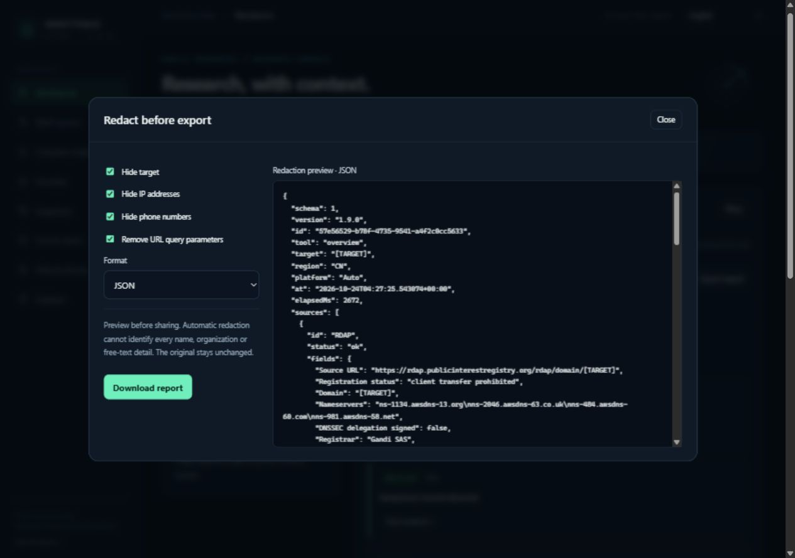
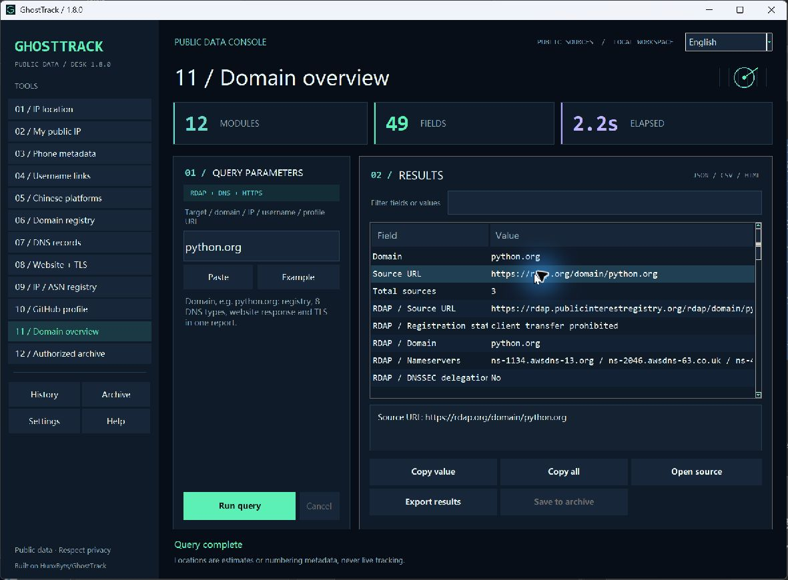
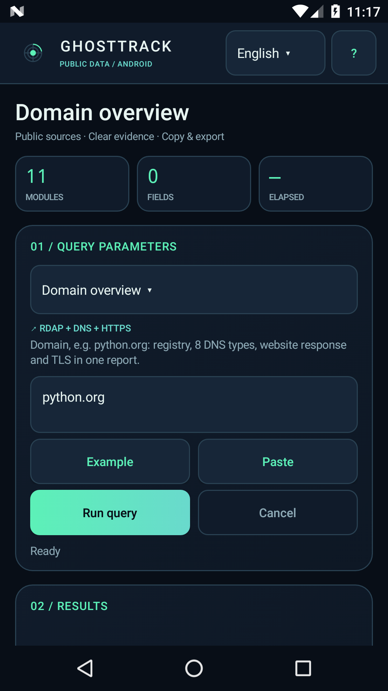
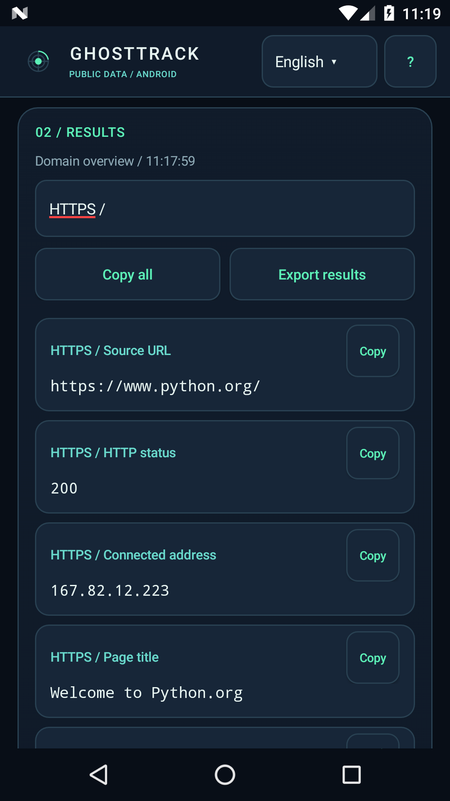

# GhostTrack Console

**English** · [简体中文](README.zh-CN.md) · [日本語](README.ja.md) · [Español](README.es.md) · [Français](README.fr.md)

**A public-information research workbench for Windows and Android.**

Investigate a domain, inspect its DNS and TLS, review network registration, and collect public profile metadata from one console. GhostTrack presents returned data as searchable fields with source context, copy actions, and JSON, CSV, or standalone HTML reports.

[Download](#download) · [Screenshots](#screenshots) · [Features](docs/FEATURES.md) · [Windows guide](docs/windows.md) · [Android guide](docs/android.md) · [Changelog](CHANGELOG.md)

**New in Windows 1.9.0: Atlas.** [Open the hosted workbench](https://ghosttrack-atlas.orangefawn9.chatgpt.site), or select **Atlas ↗** in the Windows application for the full local engine. Interpret query evidence, check domain health, compare saved snapshots, run paced domain batches, save favorites, preview redaction, export reports, inspect source status, and check releases. [Atlas guide and runtime limits](docs/atlas.md).

- **One domain, three sources.** Query RDAP, eight DNS record types, and HTTPS/TLS in parallel. Each source keeps its own status, so partial results remain useful.
- **A workspace for the whole result.** Use the Windows two-column console or native Android interface to filter fields, inspect long values, copy evidence, and export reports with query context.
- **Desktop and mobile, ready to run.** Twelve Windows tools and eleven Android modules share the query engine. Release packages include Python; the interface supports English, Simplified Chinese, Japanese, and Spanish.

## Screenshots

### Atlas · v1.9.0




The hosted version supports seven public-data tools. Address-pinned HTTPS/TLS, offline phone metadata and Chinese public-profile queries require the local engine; hosted limits are shown explicitly. Browser snapshots and favorites are saved only when you request it.

### Classic Windows console · v1.8.0 reference



The input and source notes stay beside the results table. Metric cards show the actual field count and elapsed time; the detail pane shows the selected value in full.

### Android · v1.6.0

<p>
  
  
</p>

These are captures of the released applications using public example data. See the [screenshot inventory](docs/screenshots/README.md) for versions and capture details.

## Download

| Platform | Release package | Requirements |
| --- | --- | --- |
| Windows · **1.9.0** | [Portable ZIP](https://github.com/Serennity007/GhostTrack/releases/download/windows-v1.9.0/GhostTrack-v1.9.0-Windows-x64.zip) · [Release notes and checksums](https://github.com/Serennity007/GhostTrack/releases/tag/windows-v1.9.0) | Windows 10/11, x64 |
| Android · **1.6.0** | [Universal APK](https://github.com/Serennity007/GhostTrack/releases/download/android-v1.6.0/GhostTrack-v1.6.0-Android-universal.apk) · [Release notes, checksums and signature](https://github.com/Serennity007/GhostTrack/releases/tag/android-v1.6.0) | Android 7.0+, ARM64 / ARMv7 / x86_64 |
| Atlas web · **1.9.0** | [Open workbench](https://ghosttrack-atlas.orangefawn9.chatgpt.site) · [Guide](docs/atlas.md) | Modern browser; see hosted capability limits |

**Windows:** extract the entire ZIP, then run `GhostTrack/GhostTrack.exe`. Keep the executable with its bundled files. No separate Python installation is needed.

**Android:** open the APK from your file manager and install it. First launch extracts the bundled runtime. Future updates must use the same signing certificate. See the [Android guide](docs/android.md) for installation and verification.

Windows and Android have separate version numbers and release tags. The current Android release does not include the Windows authorized archive.

## Features

All network results depend on what the source returns. The [full feature catalogue](docs/FEATURES.md) describes fields, input formats, providers, and limits for each tool.

| Tool | Input | Result | Windows | Android |
| --- | --- | --- | :---: | :---: |
| Domain overview | `python.org` | Parallel RDAP, DNS, HTTPS/TLS report with per-source status | ✓ | ✓ |
| Domain registration | Domain | Registrar, registration/update/expiry dates, DNSSEC, name servers | ✓ | ✓ |
| DNS records | Domain | A, AAAA, CNAME, MX, NS, TXT, SOA, CAA and TTL | ✓ | ✓ |
| Website and certificate | Public HTTPS URL | Status, title, redirects, selected headers, certificate issuer/validity/SAN | ✓ | ✓ |
| IP / ASN registration | Public IP or `AS15169` | Registered ranges, CIDR, network identifiers and dates | ✓ | ✓ |
| GitHub public profile | Username or profile URL | Public bio, counts, creation date and five recent public repositories | ✓ | ✓ |
| Chinese platform profiles | Profile URL, supported share text or platform ID | Readable public title/description, access status and source context | ✓ | ✓ |
| IP location | Public IPv4 / IPv6 | Database location estimate, network organization, ASN and time zone | ✓ | ✓ |
| My public IP | No input | Current network's public egress IP | ✓ | ✓ |
| Phone metadata | Phone number and default region | Offline formatting, numbering region, carrier metadata, validity and time zones | ✓ | ✓ |
| Username links | Username | Generated GitHub, Instagram and X links; account existence is unverified | ✓ | ✓ |
| Authorized archive | Saved phone number or keyword | Search user-supplied phone/profile associations stored locally | ✓ | — |

**Chinese platforms:** Douyin, Xiaohongshu, Kuaishou, Bilibili, Weibo, Zhihu, and Douban. Prefer complete profile URLs. Supported Douyin and Xiaohongshu profile share links can be expanded. Display names, phone numbers, video links, and note links do not replace the required profile identifier.

### From query to report

1. Select a tool and enter a target. **Example** fills a sample without sending a request.
2. Run the query. Review source status alongside the available fields; cancel when needed.
3. Filter fields or values and copy one value or all results. Windows provides a row detail pane and **Open source**; Android presents selectable result cards.
4. Export **JSON**, **UTF-8 BOM CSV**, or **standalone HTML** with tool, input, and UTC query time. CSV protects formula-like values; HTML escapes returned text.

Windows adds keyboard shortcuts, up to 50 history entries, optional history persistence, and an archive dialog for saving, searching, exporting, or deleting declared associations. Android uses touch controls and the system document picker for exports. See the platform guides for exact controls and storage behavior.

## Data and limits

Network requests go directly to the relevant RDAP service, Google Public DNS, GitHub public API, ipwho.is, api.ipify.org, or the public website you query. There is no project relay service, application account, or analytics telemetry. [Privacy and data handling](docs/PRIVACY.md) covers what leaves the device, local files, clipboard/export behavior, and Android activity restoration.

Login requirements, CAPTCHAs, JavaScript, rate limits, and outages may limit the returned fields. Access status and HTTP 200 do not prove account ownership or identity. Website requests validate TLS, accept public HTTPS on port 443, restrict redirects, and bound response size. Domain registration results omit registrant contact details.

Phone metadata describes a numbering plan; IP location is a database estimate. Neither provides a live device location. The Windows archive searches associations you explicitly supply with a source declaration; it does not discover private accounts from phone numbers or establish a shared identity across platforms.

## Run from source

Use **Python 3.11**. The desktop interface uses Tkinter; on Windows it is included in the standard Python installer.

```powershell
git clone https://github.com/Serennity007/GhostTrack.git
cd GhostTrack
python -m venv .venv
.\.venv\Scripts\python.exe -m pip install -r requirements-build.txt
.\.venv\Scripts\python.exe -m unittest discover -v
.\.venv\Scripts\python.exe desktop.py
```

The original upstream entry point, `GhostTR.py`, is retained. The console documented here starts with `desktop.py`; Android uses its native application and shared Python modules.

### Build packages

```powershell
# Windows portable package and SHA256 file
.\.venv\Scripts\python.exe build_windows.py

# Android: JDK 17, SDK Platform 36 and Build Tools 36.0.0
$env:JAVA_HOME = 'path to JDK 17'
$env:ANDROID_HOME = 'path to Android SDK'
.\.venv\Scripts\python.exe build_android.py --gradle .\android\gradlew.bat
```

Build scripts run the Python tests. The Android build also runs Lint and verifies the signed APK. Preserve its signing backup outside Git for future updates. Follow the [Windows](docs/windows.md#run-and-build-from-source) and [Android](docs/android.md#build-from-source) guides for prerequisites, output paths, and signing details. A [Windows Actions workflow example](docs/windows-workflow.example.yml) is supplied as a template; it is not an active hosted release workflow.

To publish Atlas directly to your own Cloudflare account with a `workers.dev` URL, follow the [Cloudflare deployment guide](cloudflare/README.md). The same self-contained Worker bundle is used by Sites and direct Cloudflare deployment; account authorization is required before publishing to your account.

## Documentation and participation

English is the primary language for the repository home, technical guides, changelog, and contribution templates. Localized project introductions are available in [简体中文](README.zh-CN.md), [日本語](README.ja.md), [Español](README.es.md), and [Français](README.fr.md). French is a documentation language; it is not currently an interface language.

| Need | Start here |
| --- | --- |
| All tools, fields and source limits | [Feature catalogue](docs/FEATURES.md) |
| Health checks, snapshots, batch queues, favorites and redaction | [Atlas guide](docs/atlas.md) |
| Installation, controls, export and troubleshooting | [Windows guide](docs/windows.md) · [Android guide](docs/android.md) |
| Storage, providers and permissions | [Privacy and data handling](docs/PRIVACY.md) |
| Release history | [English changelog](CHANGELOG.md) · [中文更新记录](CHANGELOG.zh-CN.md) |
| Report a bug or suggest a feature | [Issue forms](https://github.com/Serennity007/GhostTrack/issues/new/choose) · [Support](SUPPORT.md) |
| Contribute code, translations or screenshots | [Contributing](CONTRIBUTING.md) · [Maintenance checklist](docs/maintenance.md) |
| Report a security vulnerability privately | [Security policy](SECURITY.md) |

Issue reports should include the platform, version, steps, and a redacted example. Remove personal query history, private URLs, tokens, and signing credentials before sharing logs or screenshots.

## Attribution and license status

This fork extends [HunxByts/GhostTrack](https://github.com/HunxByts/GhostTrack). The [original README](UPSTREAM_README.md), credits, and CLI entry point are retained. GhostTrack Console is not an official client of the queried platforms.

No project-wide license is currently declared in this repository. Third-party dependencies retain their own licenses.
