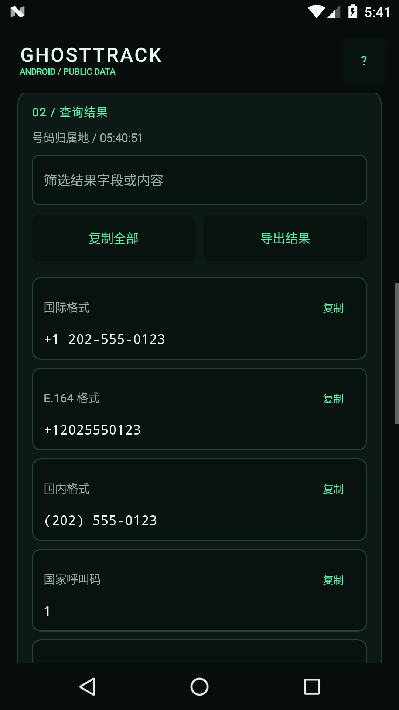

# GhostTrack Android 1.6.0

[中文项目主页](README.zh-CN.md) · [English guide](docs/android.md) · [Windows 使用说明](README_WINDOWS.md) · [中文更新记录](CHANGELOG.zh-CN.md)

Android 原生触屏界面，复用 Windows 版的公开查询服务；支持简体中文、English、日本語、Español。

 

## 安装

在 [GitHub Release](https://github.com/Serennity007/GhostTrack/releases) 下载 `GhostTrack-v1.6.0-Android-universal.apk`，在手机文件管理器中打开安装。支持 Android 7.0 及以上，ARM64、ARMv7 和 x86_64；首次启动需要解压内置查询运行环境，可能稍慢。

系统若提示来源权限，只为你实际用于打开 APK 的应用授权。此安装包通过项目专用发布证书签名，不是 Google Play 商店版本。更新时请使用同一仓库发布、同一证书签名的安装包。

## 功能

- 11 个查询模块：域名综合报告、域名档案、8 类 DNS、网站与 TLS、IP/ASN 注册、IP 归属地、本机公网 IP、号码段元数据、用户名链接、GitHub 公开资料、国内公开主页。
- 抖音、小红书、快手、B站、微博、知乎、豆瓣：粘贴公开主页链接或受支持的分享文案；不按手机号关联私人账号。
- 原生黑绿控制台、来源标识、真实耗时与字段数量；按字段或内容筛选。
- 单项复制、复制全部、示例填入和主动粘贴；取消后忽略迟到结果。
- 通过 Android 文件选择器保存 JSON、CSV、HTML，不申请整盘存储权限。CSV 带 UTF-8 BOM 和公式文本保护；HTML 离线可读。
- 仅记住语言和模块；不持久保存查询历史。当前结果在应用关闭或被系统回收后可能丢失，请及时导出。

只有联网权限；无需定位、通讯录、短信、电话或账号登录权限。号码段归属地和 IP 数据库位置是元数据，不是设备实时位置。平台验证、登录、脚本和限流可能使结果不完整，界面会显示可获得的信息与状态。需要网络的模块直接访问相应公开来源，没有项目中转服务器。

## 构建

需要 JDK 17、Gradle 8.13、Android SDK Platform 36、Build Tools 36.0.0、Python 3.11，以及可访问 Google Maven、Maven Central、PyPI 的网络。Android Gradle Plugin 8.13.2 与 Chaquopy 17.1.0 已固定；Python 依赖与桌面版共用 `requirements.txt`。

```powershell
$env:JAVA_HOME = '你的 JDK 17 目录'
$env:ANDROID_HOME = '你的 Android SDK 目录'
.\.venv\Scripts\python.exe build_android.py --gradle '你的 Gradle 8.13\bin\gradle.bat'
```

构建脚本先运行测试，然后构建发布 APK、运行 Android Lint、验证 APK 签名，并生成 SHA256 文件。Gradle 的 `syncSharedPython` 会将六个共享服务模块复制到生成目录，不在 Android 工程内维护第二份业务实现。

首次发布构建会在 `%LOCALAPPDATA%\GhostTrackBuild` 创建专用签名密钥和凭据，限制为当前 Windows 用户与 SYSTEM 访问。**请安全备份这个目录**：丢失签名密钥后，无法给已安装版本提供原位升级。不要把该目录、密钥或密码上传 GitHub。其他平台请备份 `~/.local/share/GhostTrackBuild`，构建脚本对密钥与凭据设为仅当前用户可读写。

APK 与校验文件在 `dist/`；签名摘要只包含公开证书信息。仓库不包含私钥和构建机路径。GitHub Actions 自动发布尚未配置，本次 APK 在本机工具链构建。

## 发布验证

65 项自动测试通过，Android Lint 0 错误。Android 7.0 x86_64 模拟器已验证安装、首次启动、四语言切换、离线号码元数据、复制后粘贴，以及联网域名综合查询和实际 JSON 文件导出。`python.org` 返回49字段、3个成功来源，页面标题为 `Welcome to Python.org`。ARM 真机与其他系统版本尚未实测。

## 开发来源

- [Android 构建兼容性](https://developer.android.com/build/releases/agp-8-13-0-release-notes)
- [Chaquopy Android 集成与运行要求](https://chaquo.com/chaquopy/doc/current/android.html)
- 原项目：[HunxByts/GhostTrack](https://github.com/HunxByts/GhostTrack)
