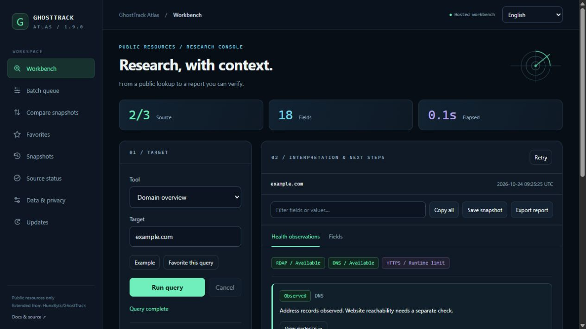
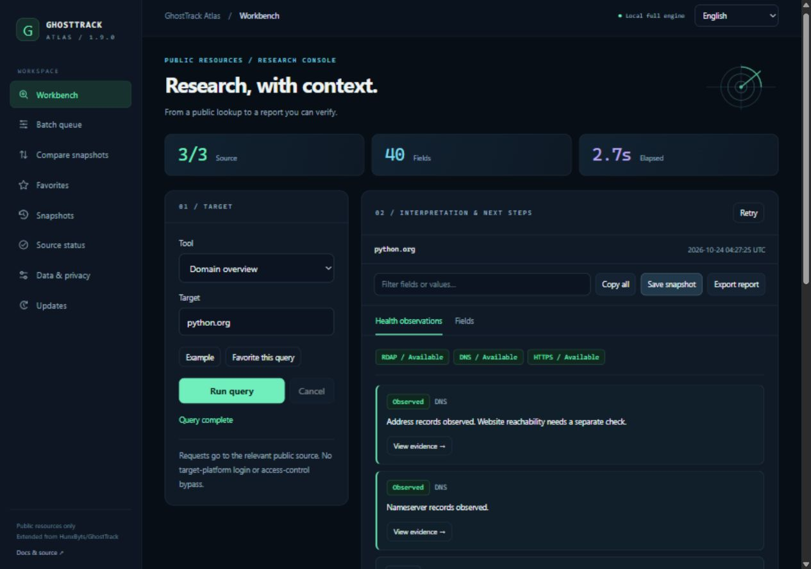
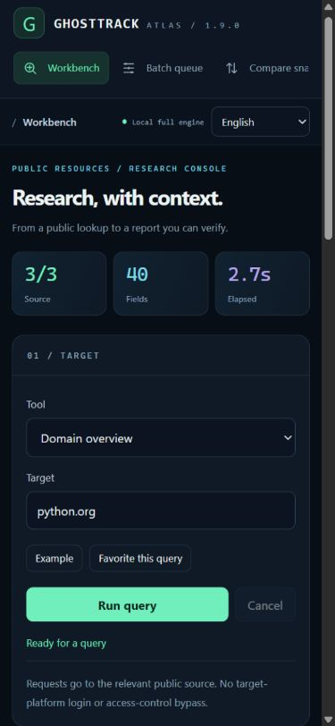

# GhostTrack Atlas

[English home](../README.md) · [Windows guide](windows.md) · [Privacy](PRIVACY.md)

Atlas is the browser workspace introduced with Windows **1.9.0**. It adds health observations, field explanations, snapshot comparison, a paced domain queue, browser-local favorites, redaction previews, source status, and release checks. It reuses the desktop query engine locally; the hosted adapter supports a smaller set of public-source queries.

**[Open the public hosted workbench](https://ghosttrack-atlas.1392452425a.workers.dev)**. No separate desktop installation is required for the hosted tools. The primary public deployment runs in the project owner's Cloudflare Workers account. The [previous Sites deployment](https://ghosttrack-atlas.orangefawn9.chatgpt.site) remains available as an alternate; saved browser data is separate on each origin.







## Open the workbench

On Windows, extract the complete 1.9.0 package, start `GhostTrack.exe`, and select **Atlas ↗** at the top. The application opens `http://127.0.0.1:8765` in your browser. Keep the desktop application running while using the local workbench.

From a Python source checkout:

```powershell
.\.venv\Scripts\python.exe web_console.py
# Optional: --no-browser --port 8765
```

The local service binds only to loopback. It checks Host, Origin, and a per-process request token; it does not expose the archive or desktop history. If port 8765 is occupied, the desktop shows an error instead of opening an unknown service. Close the other Atlas instance and retry.

## Local and hosted capabilities

| Tool or behavior | Local Python engine | Hosted Worker |
| --- | --- | --- |
| Domain overview, registration, eight DNS types | Yes | Yes |
| IP / ASN registration, GitHub public profiles | Yes | Yes |
| IP database estimate, generated username links | Yes | Yes |
| Validated, address-pinned HTTPS and raw TLS metadata | Yes | Unavailable, shown explicitly |
| Offline phone metadata, Chinese public profiles | Yes | Unavailable, disabled in the selector |
| Health observations, field explanations | Based on available source fields | Based on available source fields |
| Snapshot comparison, favorites, queue, redaction and reports | Yes | Yes |
| Windows authorized account archive | Use the existing desktop dialog | Unavailable |

The hosted environment cannot pin an arbitrary website connection to a validated public address or inspect its raw TLS certificate. Atlas therefore does not fetch user-entered website URLs from that runtime. The HTTPS source is marked **Runtime limit**, and DNS/registration results remain usable. A missing certificate is unknown, not a successful TLS check.

The hosted adapter permits only fixed public API hosts and RDAP registry hosts from IANA's official bootstrap. It bounds redirects and response sizes. It has no database, analytics, user-account collection, or runtime secret requirement. Published access settings are managed by the hosting platform; a private publication is not an anonymous public demo.

## Health observations and explanations

Run a domain overview to see address and nameserver availability, NXDOMAIN, certificate lifetime, HTTP status, redirect observations, RDAP expiry, and response-header review items where evidence exists.

Each observation includes its source and an action to inspect the original fields. Select a field to read its explanation. Recommendations describe a check to make, rather than claiming that one missing header proves a vulnerability. MX/SPF advice applies to mail use; missing NS on a subdomain can be expected.

Certificate days are those recorded during the query. RDAP expiry advice uses the snapshot's query time. Provider failures and partial responses stay explicit. There is no synthetic security score or certification.

## Snapshots and comparison

Select **Save snapshot** after a query. Saving is explicit: refreshing or closing a page does not automatically save its current result. The browser holds up to 50 snapshots, subject to a shared approximately 1.9-million-character storage bound. Storage errors preserve the prior saved state and suggest exporting a backup.

Select two snapshots with the same tool, normalized target, region, and platform in **Compare snapshots**. The result separates added, removed, and changed fields with before/after values. Only sources successful in both queries are compared. Failed, missing, limited, or partial sources are listed as skipped, so an outage does not look like deleted records.

By default, DNS answer order and TTL countdown are ignored. You can include TTL changes. Query timing, source URLs, response duration, and the naturally decreasing certificate-day count do not create differences. An unchanged result means no changes among the comparable fields, not a guarantee that the resource is unchanged everywhere.

Export a JSON snapshot with redaction options turned off to retain a reusable original. The snapshot page can import a single bounded JSON report. Redacted reports are for sharing and may no longer contain a runnable target.

## Batch queue and favorites

Use one domain per line, up to 50. The TXT / single-column CSV importer accepts a `domain` or `target` header, validates the complete list, normalizes names, and removes duplicates before issuing requests.

The queue runs one domain at a time with a 1.25-second gap after each result. Pause stops scheduling the next item; the active query can finish. Cancel aborts the active request, signals its server job, and marks remaining items cancelled. Retry incomplete items retains completed results. HTTP 429 responses receive at most two automatic retries using the bounded retry delay. Provider-level partial failures remain visible for manual retry.

Results are held in page memory until saved or exported. Opening a queue item uses the same evidence view as a single query. Batch export includes the collected reports and each source's status. The local service allows two active queries and 60 query/update requests per minute. Hosted rate/concurrency limits are best-effort per Worker isolate, not a global quota guarantee.

Favorites explicitly save the tool, target, phone region and platform, not result data. Up to 50 are stored in this browser; opening a favorite fills the form without sending a request.

## Copy, redaction and report export

Copy individual fields or the complete original result. Copy actions do not automatically redact; review the clipboard before sharing.

Report export includes the raw source fields and derived health observations with explanations in the selected interface language. It opens a preview with independent options to hide the target, IP addresses, recognized phone formats, and URL query parameters. All are enabled initially. Adjust them, inspect the JSON preview, and then download JSON, UTF-8 BOM CSV, or a standalone HTML report. Batch and comparison exports use the same controls.

Redaction works on a copy and does not alter the original result. It preserves observation timestamps and report identifiers. Automatic detection cannot recognize every personal detail, organization, free-text identifier, or number format; manually review the preview. CSV protects formula-like text, and HTML escapes returned values and uses no external scripts or assets.

## Source status and updates

**Source status** shows the selected query's actual source states, duration, errors, time, and available source links. It is not a global uptime monitor. Retry issues a fresh query and preserves the original snapshot if you saved it.

**Updates** reads stable release metadata from this GitHub repository when you select **Check GitHub releases**. It displays separate Windows and Android versions and official release-page links. It never automatically downloads or executes a package. API failure is shown as unavailable metadata, not a claim that you are up to date.

## Data lifecycle

Snapshots, favorites, and the language preference use `ghosttrack.atlas.v1` in browser localStorage. They are unencrypted and scoped to the exact origin: local versus hosted mode, a different port, browser profile, or hostname has separate data. Export reports to transfer information between them. The privacy page can remove Atlas's saved browser data after confirmation; it does not delete desktop history, the account archive, downloaded reports, or clipboard contents.

Source providers receive the target and observe the connection. The local server records no query log or report database. Browser extensions, clipboard managers, document storage and hosting infrastructure have their own behavior. See [Privacy and data flow](PRIVACY.md).

## Development and verification

```powershell
.\.venv\Scripts\python.exe -m unittest discover -v
node --test web/core.test.mjs web/cloud.test.mjs
```

Python tests cover public-engine adaptation, partial failures, loopback boundaries, cancellation, concurrency, and the desktop lifecycle. JavaScript tests cover evidence rules, failed-source comparison, TTL/order noise, redaction, report injection protection, hosted redirects and capability limits. Browser checks should additionally exercise real public queries, copy, exports, queue controls, persistence, and narrow/wide layouts.

`web/build_site.mjs` embeds the application and hosted adapter into an initialized Sites Worker checkout. It preserves the registered Site identity. Hosted publication uses the Sites source/version/deployment workflow and does not publish the application through WorkBuddy. Confirm any contest-specific publishing requirements separately.
